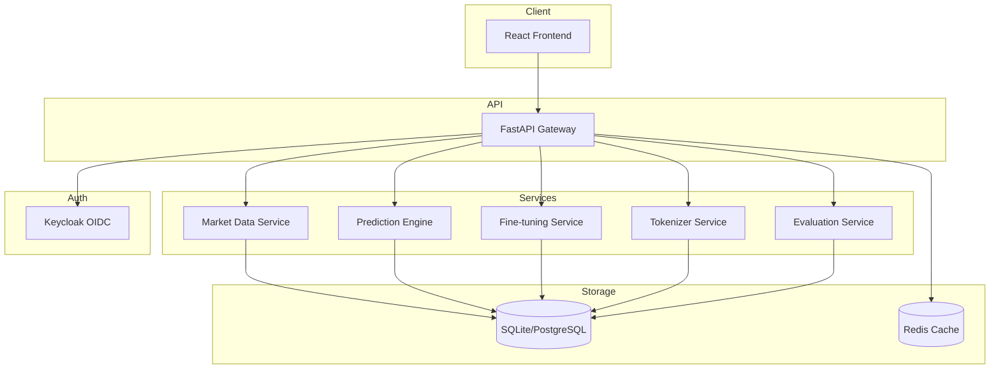

# Prism Foundry - Kronos

> Work in progress. This checkpoint may be incomplete or fail tests. See PLAN.md and STATUS.md before use.


**Kronos: A Foundation Model for the Language of Financial Markets**

Ryan Vo | AI & Machine Learning

## Overview

Prism Foundry implements Kronos, a foundation model for financial time series prediction. It provides a complete platform for market data ingestion, tokenization, prediction generation, model evaluation, and fine-tuning workflows. The system is designed for AI/ML researchers and quantitative analysts who need reproducible, auditable financial forecasting with comprehensive evaluation metrics (MAE, RMSE, MAPE, Correlation).

## Architecture



## Features

- **Market Data Ingestion**: Fetch, store, and manage OHLCV data with pagination, filtering, and multiple source support
- **Kronos Tokenizer**: Deterministic offline tokenization of price sequences for foundation model input
- **Prediction Engine**: Generate multi-step predictions with configurable context/prediction windows
- **Model Evaluation**: Comprehensive metrics (MAE, RMSE, MAPE, Correlation) with visualization
- **Fine-tuning Workflows**: Configure and track custom symbol fine-tuning runs with progress monitoring
- **OIDC Authentication**: Keycloak integration with authorization code flow, PKCE, and role-based access
- **Multi-provider LLM**: Configurable adapters for OpenAI-compatible, Anthropic, Gemini, and Ollama

## Quick Start

### Prerequisites
- Docker and Docker Compose
- Node.js 24+ (for local frontend development)
- Python 3.12+ (for local backend development)

### Using Docker Compose

```bash
# Clone and navigate
cd prism-foundry-ryan-vo

# Copy environment template
cp .env.example .env

# Start all services
docker compose up -d

# Access services
# Frontend: http://localhost:5173
# Backend API: http://localhost:8000
# API Docs: http://localhost:8000/docs
# Keycloak: http://localhost:8080 (admin/admin)
```

### Local Development

**Backend:**
```bash
cd backend
python -m venv .venv
source .venv/bin/activate
pip install -r requirements.txt
cp ../.env.example .env
uvicorn app.main:app --reload --host 127.0.0.1 --port 8000
```

**Frontend:**
```bash
cd frontend
npm install
npm run dev
```

## API Reference

### Health Checks
- `GET /health` - Application health
- `GET /health/db` - Database connectivity

### Market Data
- `GET /api/v1/market-data` - List market data (pagination, filtering)
- `GET /api/v1/market-data/symbols` - List available symbols
- `POST /api/v1/market-data` - Create market data point
- `GET /api/v1/market-data/{id}` - Get specific data point

### Predictions
- `GET /api/v1/predictions` - List predictions (pagination, filtering)
- `POST /api/v1/predictions` - Create prediction with optional evaluation
- `GET /api/v1/predictions/{id}` - Get prediction details
- `POST /api/v1/predictions/evaluate` - Evaluate metrics without storing

### Fine-tuning
- `GET /api/v1/finetune` - List fine-tune runs (pagination, filtering)
- `POST /api/v1/finetune` - Create fine-tune run
- `GET /api/v1/finetune/{id}` - Get run details
- `PATCH /api/v1/finetune/{id}` - Update run status/metrics

### Authentication
- `GET /api/v1/auth/login` - Initiate OIDC login
- `GET /api/v1/auth/callback` - OIDC callback
- `POST /api/v1/auth/logout` - Logout
- `GET /api/v1/auth/me` - Current user info

## Configuration

| Variable | Description | Default |
|----------|-------------|---------|
| `DATABASE_URL` | SQLAlchemy database URL | `sqlite+aiosqlite:///./data/prism.db` |
| `OIDC_ISSUER_URL` | Keycloak realm URL | Required for auth |
| `OIDC_CLIENT_ID` | OIDC client ID | Required for auth |
| `OIDC_CLIENT_SECRET` | OIDC client secret | Required for auth |
| `LLM_PROVIDER` | LLM provider type | `openai-compatible` |
| `LLM_MODEL` | Model identifier | `gpt-4o-mini` |
| `LLM_API_KEY` | API key for LLM | Required for LLM features |
| `DEMO_MODE` | Enable demo mode (localhost only) | `true` |

## AI/ML Evaluation

Prism Foundry includes a reproducible evaluation framework for the Kronos foundation model:

### Baseline Metrics (from upstream Kronos validation)
- **MAE**: 34.26
- **RMSE**: 53.52
- **MAPE**: 1.29%
- **Correlation**: 0.9981

### Reproducible Evaluation Command
```bash
# Run evaluation on validation dataset
python -m backend.app.services.evaluation --dataset kronos-eth-validation --model kronos-v1
```

### Limitations
- Fine-tuning on small datasets (<1000 samples) shows degraded performance
- Prediction quality depends heavily on context window alignment (400 context / 120 prediction recommended)
- Cross-market generalization requires market-specific fine-tuning
- No live trading integration - research/evaluation only

## Security

- OIDC authorization code flow with PKCE and nonce
- HttpOnly SameSite cookies for session management
- CSRF protection on state-changing operations
- Role-based access control (viewer, operator, admin)
- No credentials in logs or client-side storage
- Demo mode restricted to localhost

## SSO/SAML Setup

Keycloak supports upstream SAML IdPs through identity brokering:

1. Configure SAML IdP in Keycloak Admin Console
2. Add SAML Identity Provider to `prism` realm
3. Map SAML attributes to Keycloak user attributes
4. Update `OIDC_ISSUER_URL` to point to Keycloak realm

## Backup & Restore

```bash
# Backup SQLite database
cp backend/data/prism.db backup/prism-$(date +%Y%m%d).db

# Restore
cp backup/prism-20240101.db backend/data/prism.db
```

For production, use PostgreSQL with pg_dump/pg_restore.

## License

MIT Copyright Ryan Vo <ryandtvo@gmail.com>